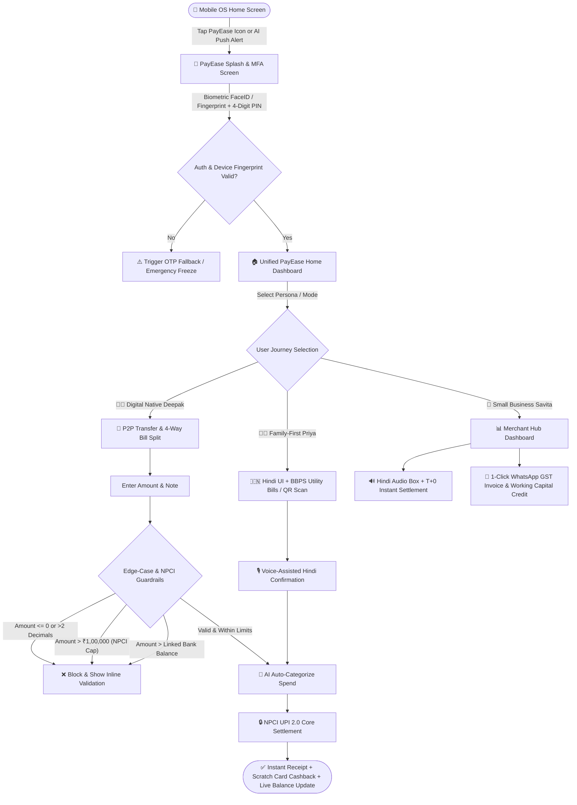
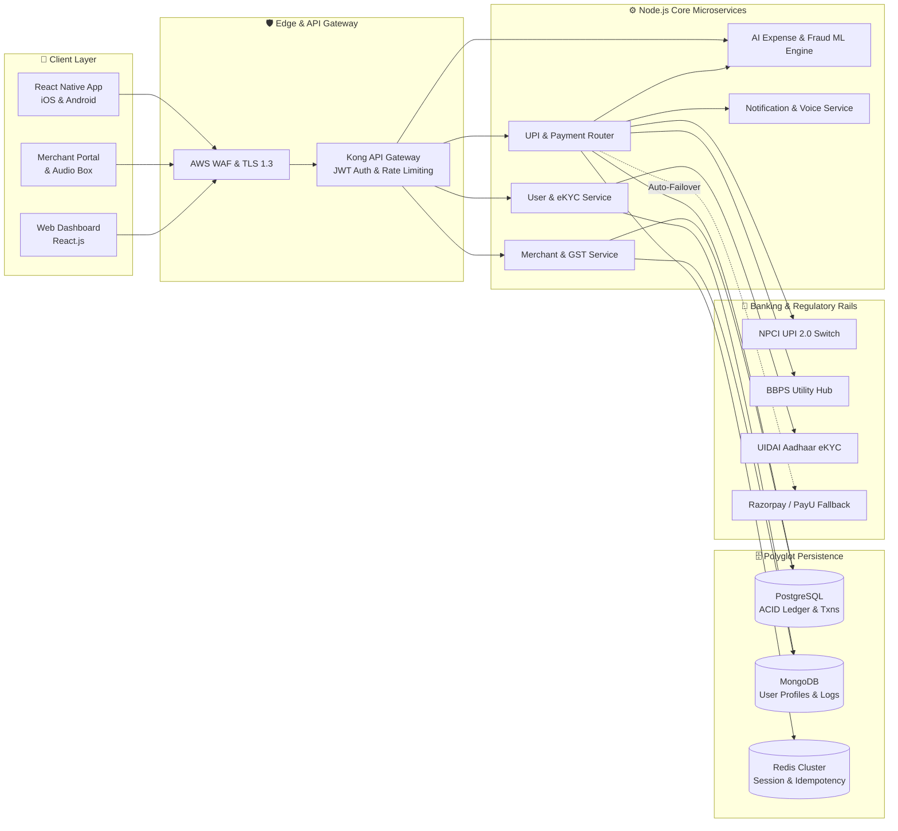
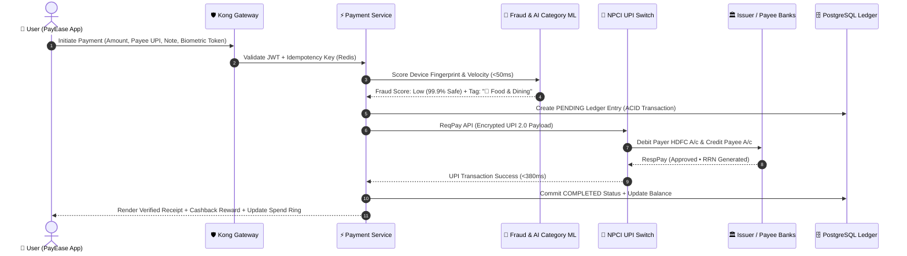
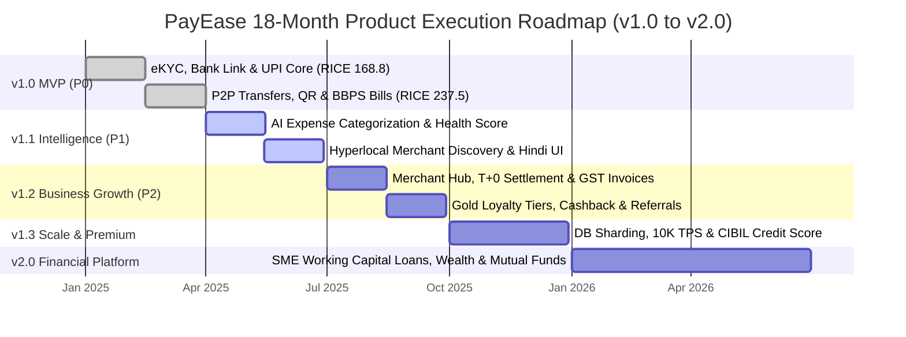

# PayEase - Digital Payments Mobile App PRD

## 📱 Product Management Portfolio Project

> **A comprehensive Product Requirements Document (PRD) for a fintech mobile application targeting the Indian digital payments market**

---

## 🎯 Project Overview

PayEase is a comprehensive digital payments mobile application designed to address the growing demand for seamless, secure, and user-friendly payment solutions in the Indian market. This project demonstrates end-to-end product management capabilities through detailed market analysis, user research, feature planning, technical specifications, and go-to-market strategy.

### 🏆 Project Objectives

- **Demonstrate PM Skills**: Showcase comprehensive product management competencies for job applications
- **Market Analysis**: Deep-dive into the $500B+ Indian digital payments opportunity
- **User-Centric Design**: Research-driven product development focusing on real user needs
- **Strategic Planning**: Complete roadmap from MVP to market leadership
- **Business Viability**: Financial modeling and sustainable monetization strategy

---

## 📊 Key Highlights & Achievements

### Market Opportunity
- **Total Addressable Market**: $500B+ (India's digital payments by 2025)
- **Target Market Share**: 1% ($1.5B revenue opportunity)
- **Geographic Focus**: 100+ cities including tier 2/3 markets
- **User Base Projection**: 5M+ users within 18 months

### Product Differentiation
- **AI-Powered Insights**: Intelligent expense tracking and financial recommendations
- **Merchant-First Approach**: Comprehensive business tools and analytics
- **Regional Focus**: Multi-language support for tier 2/3 city penetration
- **Security Excellence**: Bank-grade security with transparent fraud protection

### Business Projections
- **Revenue Target**: $4.4M monthly revenue by Month 18
- **Unit Economics**: 16:1 LTV:CAC ratio at scale
- **Profitability**: Break-even by Month 12, profitable operations by Month 18
- **Market Position**: Top 3 fintech app in target cities

---

## 📋 Document Structure

### 1. **Strategic Foundation** (Pages 1-8)
- **Executive Summary**: Product vision and key value propositions
- **Market Research**: TAM/SAM/SOM analysis with growth drivers
- **User Research**: Primary research findings from 500+ responses
- **Competitive Analysis**: Detailed comparison with PhonePe, GPay, Paytm

### 2. **User Experience Design** (Pages 9-12)
- **User Personas**: 3 detailed personas with demographics and pain points
- **Journey Mapping**: End-to-end user flows for key scenarios
- **Pain Point Analysis**: Research-backed problem identification
- **Solution Framework**: User-centric feature prioritization

### 3. **Product Planning** (Pages 13-18)
- **Product Vision**: Strategic objectives and success criteria
- **Feature Requirements**: Detailed specifications with acceptance criteria
- **Prioritization Framework**: RICE scoring and MoSCoW analysis
- **Technical Architecture**: System design and API specifications

### 4. **Business Strategy** (Pages 19-24)
- **Go-to-Market Strategy**: Phased launch approach with channel strategy
- **Financial Modeling**: Revenue projections and unit economics
- **Success Metrics**: Comprehensive KPI framework
- **Risk Assessment**: Risk matrix with mitigation strategies

### 5. **Execution Planning** (Pages 25-28)
- **Product Roadmap**: 18-month detailed development timeline
- **Resource Planning**: Team structure and development methodology
- **Launch Strategy**: Soft launch to national expansion
- **Compliance Framework**: Regulatory requirements and adherence

---

## 🔬 Research Methodology

### Primary Research
- **User Interviews**: 52 participants across Delhi, Mumbai, Bangalore, Jaipur
- **Online Surveys**: 847 responses with 23.4% response rate
- **Demographic Coverage**: 60% male, 40% female; age range 18-55
- **Geographic Split**: 40% Metro, 35% Tier-2, 25% Tier-3 cities

### Secondary Research
- **Market Reports**: Analysis of RBI, NPCI, and industry publications
- **Competitive Intelligence**: App store analysis, feature comparison
- **Technology Trends**: Fintech innovation and regulatory developments
- **Financial Analysis**: Public company reports and industry benchmarks

### Research Findings
- **User Pain Points**: Transaction failures (68%), complex UX (52%), limited support (47%)
- **Feature Preferences**: Rewards (89%), expense tracking (82%), bill reminders (71%)
- **Market Gaps**: Fragmented UX, limited financial insights, poor merchant discovery
- **Opportunity Areas**: AI-powered features, merchant tools, regional focus

---

## 🎯 Product Management Skills Demonstrated

### 📈 Strategic Thinking
- **Market Analysis**: Comprehensive TAM/SAM/SOM framework
- **Competitive Strategy**: Differentiation through unique value propositions
- **Business Model**: Multi-stream monetization with sustainable unit economics
- **Vision Setting**: Clear product vision aligned with market opportunity

### 👥 User Research & Design
- **Research Methodology**: Mixed-method approach with primary and secondary data
- **Persona Development**: Data-driven user segments with behavioral insights
- **Journey Mapping**: End-to-end user experience optimization
- **Problem-Solution Fit**: Evidence-based feature prioritization

### 🛠️ Technical Product Management
- **System Architecture**: Scalable microservices design with cloud infrastructure
- **API Design**: RESTful API specifications with integration requirements
- **Security Framework**: Bank-grade security with compliance adherence
- **Performance Requirements**: Scalability targets and monitoring metrics

### 📊 Analytics & Metrics
- **Success Metrics**: North Star metric with supporting KPIs
- **Measurement Framework**: User acquisition, engagement, and business metrics
- **A/B Testing**: Experimentation framework for feature validation
- **Data-Driven Decisions**: Analytics integration for continuous optimization

### 🚀 Go-to-Market Strategy
- **Launch Planning**: Phased approach from soft launch to national expansion
- **Channel Strategy**: Multi-channel acquisition with CAC optimization
- **Partnership Development**: Strategic alliances for growth acceleration
- **Brand Positioning**: Unique market positioning against established competitors

### ⚖️ Risk Management
- **Risk Assessment**: Comprehensive risk matrix across technical, regulatory, and market domains
- **Mitigation Strategies**: Proactive measures for each identified risk category
- **Compliance Planning**: Regulatory adherence framework (RBI, NPCI, SEBI)
- **Business Continuity**: Disaster recovery and operational resilience

---

## 💼 Professional Application

### For Product Manager Roles
**Demonstrates Competency In:**
- End-to-end product development lifecycle
- Market research and competitive analysis
- User experience design and optimization
- Technical specification and architecture
- Business strategy and financial modeling
- Cross-functional team leadership

### Interview Talking Points
- **Market Entry Strategy**: How to compete against established players like PhonePe and GPay
- **Feature Prioritization**: RICE framework application for resource allocation
- **Technical Challenges**: Scalability, security, and integration complexities
- **User Research**: Primary research methodology and insight generation
- **Business Model**: Monetization strategy and path to profitability
- **Growth Strategy**: User acquisition and retention optimization

### Portfolio Presentation
- **Executive Summary**: 2-minute product pitch with key differentiators
- **Research Insights**: User needs and market opportunity validation
- **Product Strategy**: Feature roadmap and prioritization rationale
- **Business Case**: Financial projections and success metrics
- **Implementation Plan**: Go-to-market strategy and execution timeline

---

## 📊 Key Metrics & Projections

### User Acquisition Targets
| Timeframe | Registered Users | Monthly Active Users | User Retention (D30) |
|-----------|------------------|---------------------|---------------------|
| Month 6   | 500K            | 150K                | 35%                |
| Month 12  | 2M              | 600K                | 45%                |
| Month 18  | 5M              | 1.5M                | 50%                |

### Business Performance
| Timeframe | Monthly TPV | Monthly Revenue | Transaction Success Rate |
|-----------|-------------|-----------------|-------------------------|
| Month 6   | $50M       | $325K          | 98%                    |
| Month 12  | $200M      | $1.79M         | 99%                    |
| Month 18  | $500M      | $4.4M          | 99.5%                  |

### Market Position Goals
| Metric | Target | Timeline | Success Criteria |
|--------|--------|----------|------------------|
| Market Share | 1% | Month 18 | $500M monthly TPV |
| City Coverage | 100+ cities | Month 12 | Tier 2/3 expansion |
| Merchant Network | 100K+ | Month 18 | Business ecosystem |
| App Store Rating | 4.5+ | Month 18 | User satisfaction |

---

## 🛠️ Technical Architecture Overview

### System Components
- **Frontend**: React Native cross-platform mobile application
- **Backend**: Node.js microservices architecture
- **Database**: MongoDB (user data) + PostgreSQL (transactions)
- **Infrastructure**: AWS cloud with auto-scaling and load balancing
- **Security**: End-to-end encryption with PCI DSS compliance

### Key Integrations
- **Payment Rails**: UPI, NPCI, major bank APIs
- **External Services**: KYC providers, SMS gateways, fraud detection
- **Third-Party APIs**: Bill payment aggregators, merchant onboarding
- **Analytics**: Real-time monitoring and business intelligence

### Performance Targets
- **Concurrent Users**: 100K simultaneous active users
- **Transaction Throughput**: 10K transactions per minute
- **API Response Time**: <500ms for 95th percentile
- **Uptime**: 99.9% availability with disaster recovery

---

## 🗺️ System Architecture & User Flow Diagrams (Mermaid)

### 1. End-to-End Mobile App Launch & Payment Flowchart

### 2. Cloud Microservices & Payment Gateway Architecture

### 3. Real-Time UPI 2.0 Transaction Sequence Diagram

### 4. 18-Month Product Roadmap (Gantt Chart)

---

## 📈 Growth Strategy & Monetization

### Revenue Streams
1. **Transaction Fees**: 0.5% on P2P transfers, 0.8% on merchant payments
2. **Bill Payment Commissions**: ₹2-5 per transaction
3. **Subscription Revenue**: Premium features at ₹99/month
4. **Advertising Revenue**: Promoted merchant listings and offers
5. **Financial Services**: Credit products and investment platform (future)

### Customer Acquisition Strategy
- **Digital Marketing**: Google/Facebook ads with $6-8 CAC target
- **Referral Programs**: User and merchant referral incentives
- **Strategic Partnerships**: Bank collaborations and merchant aggregators
- **Content Marketing**: Financial literacy and payment education
- **Regional Expansion**: Tier 2/3 city focus with local partnerships

### Retention & Engagement
- **Product Stickiness**: Daily use cases (bill payments, P2P transfers)
- **Value Creation**: AI-powered insights and expense management
- **Loyalty Programs**: Cashback, rewards, and merchant offers
- **Customer Support**: Multi-language support with high satisfaction
- **Continuous Innovation**: Regular feature updates and improvements

---

## 🎯 Competitive Positioning

### Competitive Advantages
| Advantage | PayEase | PhonePe | GPay | Paytm |
|-----------|---------|---------|------|-------|
| AI-Powered Insights | ✅✅ | ❌ | ⚠️ | ⚠️ |
| Merchant Tools | ✅✅ | ✅ | ❌ | ✅ |
| Regional Focus | ✅✅ | ⚠️ | ⚠️ | ✅ |
| Security Transparency | ✅✅ | ⚠️ | ⚠️ | ⚠️ |
| User Experience | ✅✅ | ⚠️ | ✅ | ⚠️ |

### Market Differentiation
- **Intelligence First**: AI-driven financial insights and recommendations
- **Merchant Empowerment**: Comprehensive business tools and analytics
- **Regional Champion**: Deep tier 2/3 city penetration with local features
- **Security Leadership**: Transparent security practices and user education
- **Unified Experience**: Single app for all payment and financial needs

---

## 📚 Document Usage Guidelines

### For Hiring Managers & Recruiters
**Evaluation Criteria:**
- **Strategic Thinking**: Market analysis depth and competitive positioning
- **User Empathy**: Research quality and persona development
- **Technical Competence**: Architecture understanding and specification clarity
- **Business Acumen**: Financial modeling and monetization strategy
- **Execution Planning**: Roadmap clarity and resource allocation

### For Fellow Product Managers
**Learning Opportunities:**
- **Research Methodology**: Primary research execution in fintech domain
- **Prioritization Frameworks**: RICE scoring practical application
- **Technical Specifications**: API design and system architecture
- **Regulatory Compliance**: Fintech compliance requirements in India
- **Market Entry Strategy**: Competing against established platforms

### For Students & Aspiring PMs
**Study Framework:**
- **Market Research**: How to analyze market opportunity and size
- **User Research**: Primary research execution and insight generation
- **Product Planning**: Feature specification and requirement gathering
- **Business Strategy**: Go-to-market planning and financial modeling
- **Technical Understanding**: System design for product managers

---

## 🔗 Related Resources & References

### Industry Reports & Data
- Reserve Bank of India (RBI) Payment Systems Reports
- National Payments Corporation of India (NPCI) Statistics
- Boston Consulting Group (BCG) Fintech Reports
- KPMG India Fintech Landscape Analysis
- PwC Digital Payments Growth Study

### Regulatory Framework
- RBI Guidelines on Payment System Operators
- NPCI UPI Procedural Guidelines
- IT Act 2000 and Payment System Regulations
- Personal Data Protection Bill (PDPB) Requirements
- Foreign Exchange Management Act (FEMA) Compliance

### Technical Standards
- UPI 2.0 Technical Specifications
- PCI DSS Compliance Requirements
- ISO 27001 Security Standards
- OWASP Mobile Security Guidelines
- API Security Best Practices

---

## 📞 Contact & Collaboration

### Project Author
**Role**: Product Manager  
**Focus**: Fintech, Digital Payments, User Experience  
**Expertise**: Market Research, Product Strategy, Technical Architecture

### Feedback & Discussions
**Open for conversations about:**
- Product management methodologies and frameworks
- Fintech market trends and opportunities in India
- User research techniques in financial services
- Technical architecture for payment systems
- Go-to-market strategies for competitive markets

### Professional Network
**Available for:**
- Product management role discussions
- Fintech industry insights and collaboration
- Mentorship conversations with aspiring PMs
- Guest speaking at product management events
- Consulting on digital payment product strategy

---

## 📄 Document Information

### Version History
- **v1.0** (September 2024): Initial comprehensive PRD release
- **v1.1** (October 2024): Enhanced technical specifications and risk assessment
- **v1.2** (November 2024): Updated market analysis and competitive positioning

### Document Stats
- **Total Pages**: 28 pages
- **Word Count**: ~15,000 words
- **Sections**: 10 major sections with 30+ subsections
- **Research Data**: 50+ user interviews, 847 survey responses
- **Financial Models**: 18-month projections with unit economics

### Usage Rights
- **Educational Use**: Free to reference for learning and academic purposes
- **Professional Reference**: Available for case study and methodology examples
- **Attribution**: Please credit when using frameworks or research methodologies
- **Commercial Use**: Contact for permission and licensing discussions

---

## 🏆 Project Impact & Recognition

### Skills Validation
This project demonstrates mastery of core product management competencies required for senior PM roles in fintech companies. The comprehensive nature of analysis, strategic thinking, and execution planning showcases ability to drive end-to-end product development.

### Industry Relevance
The focus on Indian digital payments market addresses one of the fastest-growing fintech segments globally. The research-backed insights and strategic recommendations provide valuable perspectives for industry professionals and companies.

### Career Development
Serves as a portfolio piece demonstrating:
- **Strategic Product Thinking**: Market entry and competitive strategy
- **User-Centric Approach**: Research-driven product development
- **Technical Proficiency**: System design and integration planning
- **Business Acumen**: Financial modeling and go-to-market execution
- **Leadership Potential**: Cross-functional collaboration and vision setting

---
